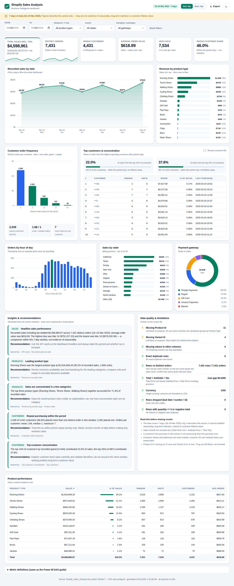

# Shopify Sales Analysis — Dashboard (Flask backend + web frontend)

An interactive business-intelligence dashboard built from your *Shopify Sales Analysis Project Package*.
A Python/Flask backend reads the sales workbook, computes every metric with pandas, and serves a
JSON API plus a professional single-page dashboard.



| | |
|---|---|
| **Backend** | Python · Flask · pandas · openpyxl (3 pip packages) |
| **Frontend** | Plain HTML / CSS / JavaScript with hand-built SVG charts. **No Node.js, no build step, no CDN.** |
| **Data** | `data/Shopify_Sales_Cleaned.xlsx` — 7,431 orders, 18–24 March 2025 |
| **Tests** | 56 backend tests + 75 browser checks (all passing when this was built) |

---

## 1. Step-by-step: run it

### Windows (Command Prompt or the VS Code terminal)

**Step 1 — Check Python.** Open a terminal and run:
```bat
python --version
```
You need Python **3.10 or newer**. If you see *"'python' is not recognized"*, try `py --version`.
If that also fails, install Python from https://www.python.org/downloads/ and **tick "Add python.exe to PATH"**
on the first installer screen, then close and reopen the terminal.

**Step 2 — Open the project folder.** Unzip the download, then in VS Code use *File → Open Folder…* and pick
the `shopify_dashboard` folder. Open a terminal with *Terminal → New Terminal*.

**Step 3 — Create a virtual environment** (an isolated place for the packages):
```bat
python -m venv .venv
```
(use `py -m venv .venv` if `python` is not recognized)

**Step 4 — Activate it:**
```bat
.venv\Scripts\activate
```
Your prompt now starts with `(.venv)`.
*PowerShell says "running scripts is disabled"?* Run `Set-ExecutionPolicy -Scope Process Bypass` first, or just use Command Prompt.

**Step 5 — Install the packages:**
```bat
python -m pip install -r requirements.txt
```
(Using `python -m pip` avoids the *"'pip' is not recognized"* error.)

**Step 6 — (Recommended) Run the tests** to prove everything works on your machine:
```bat
python -m unittest discover -s tests -t . -v
```
You should see `Ran 56 tests … OK` (takes about 20 seconds).

**Step 7 — Start the dashboard:**
```bat
python run.py
```
Your browser opens at **http://127.0.0.1:5000**. If it doesn't, open that address yourself.
Leave the terminal open while you use the dashboard. Press **Ctrl+C** in the terminal to stop it.

### macOS / Linux
```bash
python3 -m venv .venv
source .venv/bin/activate
python -m pip install -r requirements.txt
python -m unittest discover -s tests -t . -v
python run.py
```

### Useful options
| Command | What it does |
|---|---|
| `python run.py --port 5001` | Use another port (if 5000 is busy) |
| `python run.py --no-browser` | Don't open the browser automatically |
| `python run.py --data "C:\path\Shopify Sales.xlsx"` | Use a different file (the original export works; sheet `shopify_sales` is auto-detected; `.csv` also works) |

---

## 2. How to use the dashboard

| Control | What it does |
|---|---|
| **From / To** | Date range slicer |
| **Product type / State / Payment gateway** | Searchable multi-select slicers (empty = everything) |
| **Incl. tax / Excl. tax** | Switches the sales definition for every number and chart |
| **Click a day** on the line chart | Filters the whole dashboard to that day (click again to clear) |
| **Click a product bar** | Adds/removes that product type from the filter |
| **Filter chips** | Click a chip to remove that filter; **Reset filters** clears all |
| **Reveal customer IDs** | IDs are masked by default (privacy) |
| **Export** | Downloads the daily or product summary as CSV (follows the active filters, contains no personal data) |
| **Moon / sun icon** | Light / dark theme |
| Product table headers | Click to sort |

The address bar always reflects your filters, so you can copy the link to share an exact view.
Everything is also keyboard accessible (Tab to a bar or point, Enter to select).

---

## 3. How this maps to the project brief

| Brief requirement | Where it is |
|---|---|
| Sales performance: total sales, orders, customers, AOV | KPI cards, *Recorded sales by date*, *Orders by hour* |
| Product contribution | *Revenue by product type* chart + sortable *Product performance* table (share, orders, units, customers, avg order) |
| Customer behaviour: repeat vs one-time | *Customer order frequency* + repeat-customer card |
| Top customers / concentration | *Top customers & concentration* (top 10% = 22.0%, top 20% = 37.8% of sales) |
| Slicers: date, product type (+ state if useful) | Filter bar (also payment gateway) |
| 3–5 written insights + recommendations, backed by visuals | *Insights & recommendations* — 5 findings, each naming the visual that supports it; regenerated for the current filters |
| Data-quality notes | *Data quality & limitations* (9 automatic checks on the source file) |
| Honest limits (one week of data) | Banner at the top + the "Read this before sharing results" list |
| Revenue definition agreed (tax in/out) | Incl./Excl. tax toggle; definitions panel at the bottom |
| Customer privacy | Names and addresses are never loaded; IDs masked by default |

Metric definitions are identical to the DAX measures in `PowerBI_DAX_and_Dashboard_Guide.txt`
(also listed at the bottom of the dashboard), so this and a Power BI build will reconcile.

### Reproduces the report's numbers exactly
| Figure in the report | Dashboard |
|---|---|
| Total sales (incl. tax) | $4,598,960.87 |
| Orders / unique customers | 7,431 / 4,431 |
| Average order value | $618.89 |
| Units sold | 7,534 |
| Repeat customers | 2,039 (46.0%) |
| Top product type | Running Shoes, $1,616,946.28 (35.2%) |
| Top-3 product share | 71.3% |
| Top 10% / 20% customers' share | 22.0% (n=444) / 37.8% (n=887) |
| Peak / lowest day | 24 Mar $752,227.32 / 18 Mar $578,282.08 |
| Missing Product Id / Variant Id | 11 / 4 rows |

`tests/test_analytics.py` checks these against both the report and your `data/reference/*.csv` files.

---

## 4. Project structure

```
shopify_dashboard/
├── run.py                  ← start here (python run.py)
├── requirements.txt
├── data/
│   ├── Shopify_Sales_Cleaned.xlsx
│   └── reference/          ← CSVs from your notebook, used by the tests
├── backend/
│   ├── __init__.py         ← Flask app factory, security headers, error handlers
│   ├── config.py           ← data path, sales-basis definitions (env-var overridable)
│   ├── data_loader.py      ← load + validate + data-quality checks + drops personal fields
│   ├── filters.py          ← parse/validate slicer parameters, apply them
│   ├── analytics.py        ← all metrics (pure functions, easy to test)
│   ├── insights.py         ← generates the written findings & caveats
│   └── routes.py           ← REST API
├── frontend/
│   ├── index.html
│   ├── css/styles.css      ← light + dark themes, responsive
│   └── js/                 ← main.js (app), charts.js (SVG charts), ui.js, api.js, format.js
├── tests/
│   ├── test_analytics.py   ← 25 tests vs. report + reference CSVs
│   ├── test_api.py         ← 31 API tests (validation, privacy, exports, security headers)
│   └── e2e_browser.js      ← optional real-browser test (see below)
└── docs/                   ← screenshots
```

## 5. API reference (all GET, JSON)

All endpoints accept: `start`, `end` (`YYYY-MM-DD`), `product_type` / `province` / `gateway`
(repeat the parameter for several values), `basis` (`incl_tax` | `excl_tax`), `reveal_ids` (`true`).

| Endpoint | Returns |
|---|---|
| `/api/health` | Status, row count, data file |
| `/api/meta` | Date bounds, filter options |
| `/api/dashboard` | **Everything below in one call** (what the page uses) |
| `/api/kpis` | Sales, orders, customers, AOV, units, repeat share |
| `/api/sales/daily`, `/api/sales/hourly` | Time series |
| `/api/products` | Product summary with shares |
| `/api/customers/frequency`, `/api/customers/top` | Order-frequency buckets; top customers + concentration |
| `/api/geo/provinces`, `/api/payments` | Breakdowns |
| `/api/insights`, `/api/data-quality` | Written findings; file checks |
| `/api/export/daily.csv`, `/api/export/products.csv` | CSV downloads |

Example: `http://127.0.0.1:5000/api/kpis?product_type=Sandals&start=2025-03-20&basis=excl_tax`
Bad input returns HTTP 400 with a readable message, e.g. `{"error": "'start' must be a date in YYYY-MM-DD format…"}`.

## 6. Design decisions worth knowing

* **Why no React/Node?** Fewer things can fail on your machine: install three Python packages and run one command.
* **Slicer behaviour.** The daily and product charts keep showing every day/product (with the selection highlighted),
  like Power BI's highlight behaviour, so you can switch selection without resetting first.
* **Zero-based charts.** Area/bar axes start at 0, so differences between days are never visually exaggerated.
* **Missing IDs are never invented.** The 11 blank Product Ids and 4 Variant Ids stay blank and are reported.
* **Customer names/addresses never enter memory**, so no API response can contain them (there is a test for this).
* **Security:** read-only API, strict Content-Security-Policy, CSV formula-injection protection, input validation.

## 7. Troubleshooting

| Problem | Fix |
|---|---|
| `'python' / 'pip' is not recognized` | See Step 1; use `py` instead of `python`, and always `python -m pip` |
| `ModuleNotFoundError: flask` | The virtual environment isn't active — repeat Step 4 (look for `(.venv)`) |
| `Address already in use` | `python run.py --port 5001` |
| `Data file not found` | Keep the `data` folder next to `run.py`, or use `--data "full\path\file.xlsx"` |
| `missing required column(s)` | The message lists which; the file must contain the columns in `data/reference/data_dictionary.csv` |
| Page says *Cannot reach the backend* | The terminal running `python run.py` was closed — start it again and refresh |
| Excel file "Permission denied" | Close the workbook in Excel and retry |

## 8. Optional: browser test
```bash
npm install playwright && npx playwright install chromium
python run.py --no-browser --port 5055      # in one terminal
node tests/e2e_browser.js                    # in another (set BASE_URL to change the address)
```

## 9. Honest limitations
* **One week of data.** Findings describe this extract only; retention, seasonality and lifetime value cannot be concluded.
* Built and tested on Python 3.12 with pandas 3.0.2, Flask 3.1.3, in headless Chromium on Linux. The code avoids
  version-specific features and `requirements.txt` allows pandas ≥ 2.0, but it was **not run on Windows or on pandas 2.x**
  here — if something misbehaves there, send me the exact error message.
* `python run.py` uses Flask's development server — fine for personal/local use. For a shared deployment run it behind a
  production server such as `waitress` (`pip install waitress`, then `waitress-serve --call backend:create_app`; I did not test this deployment path).
* The order timestamps carry no time-zone information, so "orders by hour" uses the hour as exported.
